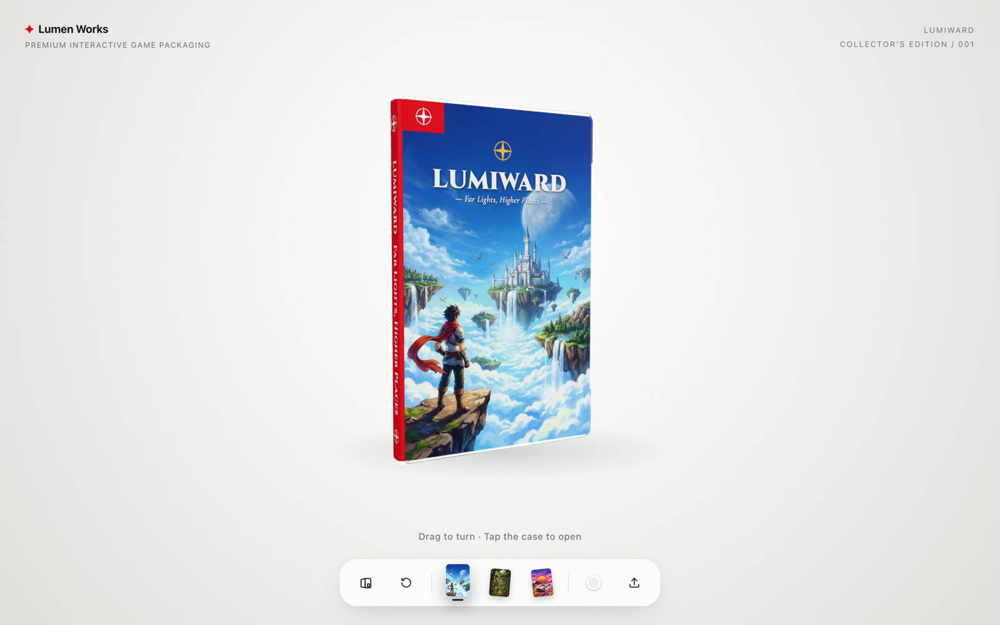
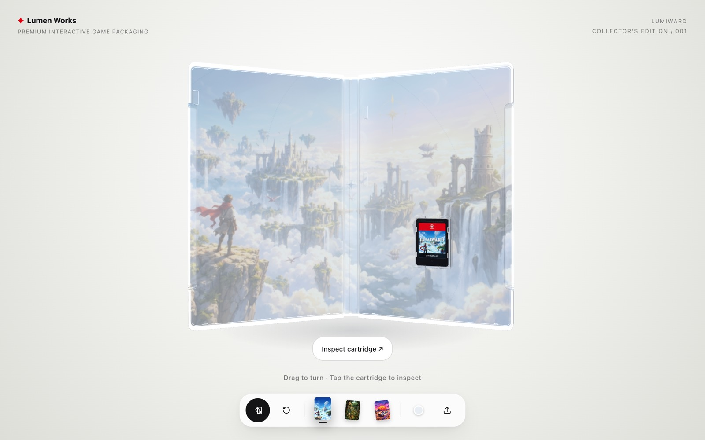
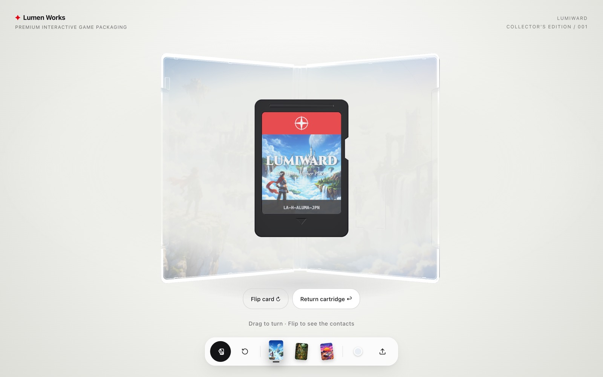
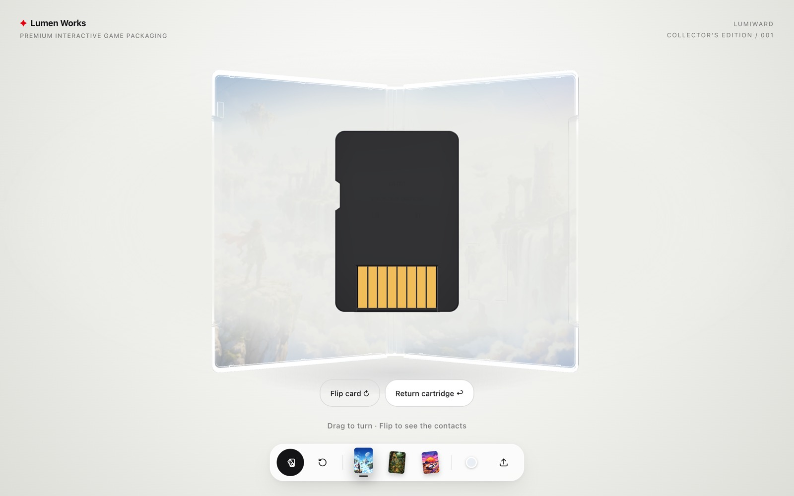

[](LICENSE)
[](https://threejs.org/)
[](https://www.typescriptlang.org/)
[](https://vite.dev/)

# Interactive Game Case

**ゲームパッケージを、ブラウザの中で手に取る。**

透明なプラスチックケースの質感から、ジャケットの印刷、カートリッジの着脱まで。ゲームソフトのパッケージをインタラクティブな3D体験として再現したWebアプリケーションです。

ケースを回転させたり、開いて中を覗いたり、カートリッジを取り出して裏返したり。実物のゲームパッケージに触れるような操作を、ブラウザ上で楽しめます。

[three.js](https://threejs.org/) と Vite を使用し、3Dモデルを読み込まず、すべての形状をコードから生成しています。

> Inspired by [CD Case](https://www.bubbbly.com/cd-case) by Ann Nguyen.

## Preview



透明なカバー越しに見えるジャケット、光を反射するプラスチックの縁、ケース内部に収まるカートリッジ。素材の質感や細部の構造にもこだわっています。

### Open the Case



ケースを開くと、内側のアートワークとカートリッジが現れます。

ヒンジの構造やケース同士の干渉を考慮し、自然な開閉アニメーションを実装しています。

### Inspect the Cartridge



カートリッジはケースから取り外して、自由に回転させることができます。



裏返すと、背面の形状や金色の接続端子まで確認できます。

## Features

- **Interactive 3D** — ドラッグやスワイプによる直感的な回転操作
- **Case Animation** — ヒンジ構造を再現したケースの開閉
- **Removable Cartridge** — カートリッジの着脱と360°の回転操作
- **Realistic Materials** — 透過・屈折・反射を組み合わせたプラスチック表現
- **Custom Artwork** — タイトルや画像を変更できるエディター
- **Visual Presets** — ジャケットデザインやケースカラーの切り替え
- **Procedural Geometry** — 外部の3Dモデルに依存しない形状生成

## Controls

マウス・タッチ操作に加え、キーボードショートカットにも対応しています。

| 操作 | アクション |
| --- | --- |
| ドラッグ / スワイプ | ケースを回転 |
| ケースをクリック / `O` | ケースを開く・閉じる |
| カートリッジをクリック / `C` | カートリッジを取り出す・戻す |
| `F` | 取り出したカートリッジを裏返す |
| `R` | ケースの向きをリセット |
| `E` | アートワークエディターを開く |
| `Esc` | カートリッジを戻す / エディターを閉じる |

画面下部のコントロールドックから、作品のプリセットやケースのカラーを変更できます。

### Customize Your Package

`E` キーでエディターを開くと、タイトルや画像を自由に変更できます。

取り込んだ画像はブラウザ内でテクスチャとして処理され、外部サーバーへのアップロードは行いません。

オリジナルのゲームパッケージを作成したり、アートワークのモックアップとして活用したりできます。

## Getting Started

### Requirements

- Node.js
- npm
- WebGLに対応したブラウザ

### Installation

リポジトリをクローンし、依存パッケージをインストールして開発サーバーを起動します。

```bash
npm install
npm run dev
```

起動後、Viteが表示するローカルURLにアクセスしてください。

通常は `http://localhost:5173` で確認できます。

### Test & Build

```bash
# テストを実行
npm test

# プロダクションビルド
npm run build
```

## Technical Details

このプロジェクトでは、three.jsによるリアルタイムレンダリングと、コードベースの形状生成を組み合わせています。

### Geometry — ケースの構造

**関連ファイル**
- [`src/model/GameCase.ts`](src/model/GameCase.ts)
- [`src/model/shapes.ts`](src/model/shapes.ts)

ケースの形状は、外部の3Dモデルを使用せずにコードから生成しています。

実物の寸法を意識した設計で、1ユニットを10mmとして扱い、ケース全体のサイズは約170 × 105 × 11mmです。

ケースの縁にはヒンジ側が開いたC字型の構造を採用。閉じた際には、その隙間に背表紙部分が収まるよう設計しています。

また、開閉時の回転を2つの軸に分散させることで、カバー同士の干渉を防いでいます。

### Materials & Lighting — 透明感とライティング

**関連ファイル**
- [`src/model/materials.ts`](src/model/materials.ts)
- [`src/scene/lighting.ts`](src/scene/lighting.ts)

透明なプラスチック特有の質感を表現するため、three.jsの `MeshPhysicalMaterial` を使用しています。

透過・屈折・クリアコートを組み合わせ、さらにGLSLによるフレネル表現を追加することで、成形されたプラスチックの縁に生じる光の反射を再現しています。

ライティングには、ソフトボックスを配置した仮想空間から生成したキューブマップを使用しています。

### Interaction & Animation — 操作とアニメーション

**関連ファイル**
- [`src/interaction/InteractionManager.ts`](src/interaction/InteractionManager.ts)
- [`src/scene/framing.ts`](src/scene/framing.ts)

ドラッグ操作には経過時間に基づく慣性を実装し、ケースを自然に回転させられるようにしています。

ケースの開閉にはGSAPを使用。カートリッジを取り出す際には、固定用のツメが広がってから本体が手前に移動するアニメーションを実装しています。

カメラ位置はケースの向きやエディターの表示状態に応じて調整され、操作中もオブジェクトが画面内に収まるよう制御しています。

### Artwork & Textures — アートワークの生成

**関連ファイル**
- [`src/art/canvasArt.ts`](src/art/canvasArt.ts)
- [`src/art/presets.ts`](src/art/presets.ts)

ジャケットやカートリッジのラベルには、Canvas APIで生成したテクスチャを使用しています。

プリセットによるデザインの切り替えに加え、ユーザーが用意した画像やタイトルを反映することもできます。

## Inspiration & Credits

**Created by ゆくらす**

本プロジェクトは、Ann Nguyen（[@ann_nnng](https://x.com/ann_nnng)）による [CD Case](https://www.bubbbly.com/cd-case) からインスピレーションを得て制作しました。

特に、透明素材のライティング表現やケースの開閉構造を参考にしています。

オリジナル作品のソースコードはこちらから確認できます。

- [CD Case — Live Demo](https://www.bubbbly.com/cd-case)
- [CD Case — Source Code](https://github.com/annnguyentt/vibe-coding/tree/main/cd-case)

オリジナルのCD Caseは、[TypingMind](https://typingmind.com) を活用して制作された作品です。

素晴らしい作品と、その実装を公開してくださったAnn Nguyen氏に感謝します。

## License

本リポジトリのコードは [MIT License](LICENSE) のもとで公開しています。
